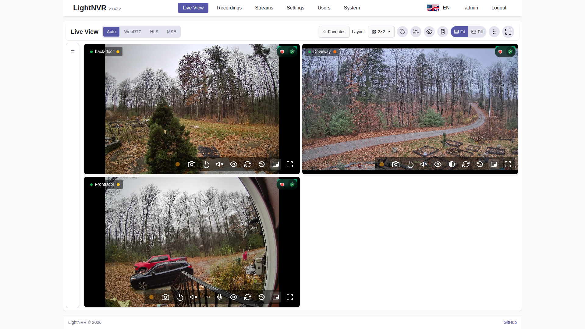
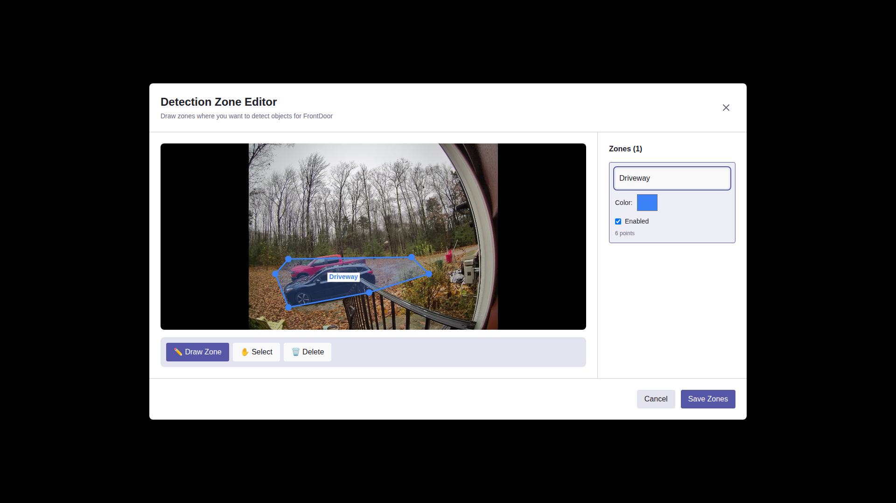
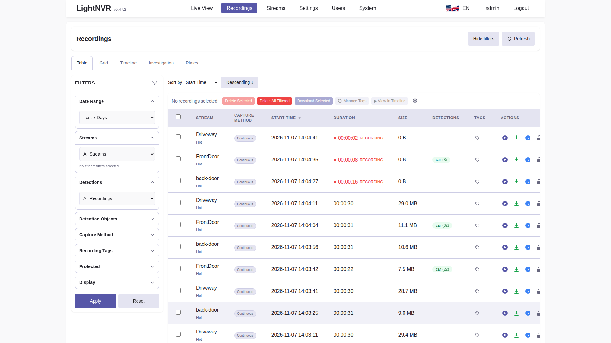
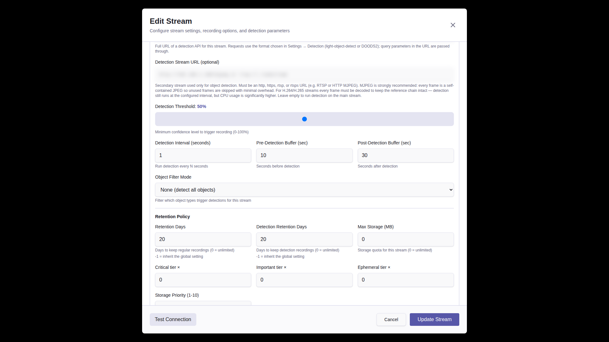
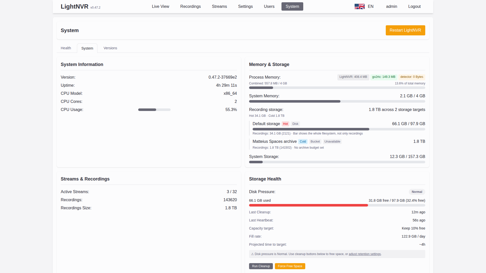

# LightNVR

[](https://www.gnu.org/licenses/gpl-3.0)
[](https://github.com/opensensor/lightNVR/pkgs/container/lightnvr)
[](https://github.com/opensensor/lightNVR/actions/workflows/integration-test.yml)
[](https://github.com/opensensor/lightNVR/actions/workflows/static-analysis.yml)
[](https://github.com/opensensor/lightNVR/actions/workflows/sanitizer.yml)
[](https://github.com/opensensor/lightNVR/actions/workflows/codeql-analysis.yml)
[](https://github.com/opensensor/lightNVR/actions/workflows/lightnvr-rs.yml)

**A self-hosted network video recorder that runs on anything from a 256 MB embedded
board to a server.** LightNVR records your IP cameras, streams them live to the browser
over WebRTC or HLS, and finds what matters with detection zones, ONVIF events and licence
plate search — all locally, with no cloud account.



> **Free to use does not mean free to build.** About $10,000 of the maintainer's own money
> has gone into LightNVR over roughly two years. If it saves you money or supports your
> customers, please help through the **[$10K Sustainability Drive](docs/SPONSORSHIP.md)** or
> **[sponsor on GitHub](https://github.com/sponsors/matteius)**.

## What it does

**Record**
- Continuous, scheduled, motion- and detection-triggered recording to standard MP4, with a
  pre-event buffer so clips include what led up to them
- Retention policies, recording protection and tags, and disk-space management
- Optional archival to S3, NFS or SAN storage ([storage & archive](docs/STORAGE_ARCHIVE.md))

**Watch**
- Live grid over WebRTC (sub-second) or HLS, with detection overlays — proxied and
  authenticated through LightNVR, built on [go2rtc](https://github.com/AlexxIT/go2rtc)
- Recordings browser, a timeline, and an **Investigation** workspace that reviews up to 16
  cameras against one shared clock without hiding gaps in footage
- Clip and multi-camera export

**Detect**
- Polygon detection zones with per-zone object classes and confidence thresholds
  ([zones](docs/ZONE_CONFIGURATION.md))
- External detection through [light-object-detect](https://github.com/opensensor/light-object-detect)
  (ONNX/TFLite) or [DOODS2](https://github.com/snowzach/doods2), or embedded
  [SOD](docs/SOD_INTEGRATION.md) for small devices ([detection engines](docs/DETECTION_ENGINES.md))
- ONVIF discovery and camera-side motion events ([ONVIF](docs/ONVIF_DETECTION.md))
- Licence plate reads with plate search

**Run it securely**
- Database-backed users with roles, TOTP multi-factor authentication and API keys
- A forced password change on first login; go2rtc's API kept on loopback
- Operational health: OS, container, filesystem and hardware sampling, incidents, and
  Prometheus metrics ([system health](docs/api/system-health.md))
- Non-root container image with all capabilities dropped

**Integrate**
- REST API with an in-app API reference ([API](docs/API.md))
- MQTT events and Home Assistant discovery ([MQTT](docs/MQTT_INTEGRATION.md),
  [Home Assistant](docs/HOME_ASSISTANT.md))

The web UI ships in 19 languages, with light and dark modes and eight colour themes.

|  |  |
|:---:|:---:|
| Detection zone editor | Recordings |
|  |  |
| Per-stream detection settings | System health |

## Quick start

### Docker Compose

```bash
mkdir lightnvr && cd lightnvr
curl -LO https://raw.githubusercontent.com/opensensor/lightNVR/main/docker-compose.yml
docker compose up -d
```

Open `http://<host>:8080`. Images are published to `ghcr.io/opensensor/lightnvr` for
`linux/amd64`, `linux/arm64` and `linux/arm/v7` on every release. Volumes, ports,
environment variables and upgrades are covered in the [Docker guide](docs/DOCKER.md).

### Other ways to install

| | |
|---|---|
| **Home Assistant** | Add [opensensor/lightnvr-hassio-addons](https://github.com/opensensor/lightnvr-hassio-addons) under *Settings → Add-ons → Add-on Store → ⋮ → Repositories*, then install LightNVR. See [Home Assistant](docs/HOME_ASSISTANT.md). |
| **Debian / Ubuntu** | `.deb` packages for amd64, arm64 and armhf are attached to each [release](https://github.com/opensensor/lightNVR/releases). |
| **Windows** | [Podman + WSL2](docs/WINDOWS_PODMAN.md) |
| **From source** | [Build guide](docs/BUILD.md): FFmpeg ≥ 7.1, Node.js 24, CMake. Required for embedded targets. |

### First login

> ⚠️ **The default login is `admin` / `admin`, and the web server listens on all
> interfaces.** Until you change the password, anyone who can reach port 8080 can see your
> cameras.

LightNVR opens a password-change screen on first login and blocks the rest of the UI until
you replace the default. To avoid the default ever being valid, set `password` in the
`[web]` section of `lightnvr.ini` before the first start. Locked out? See
[Authentication issues](docs/TROUBLESHOOTING.md#authentication-issues).

Then add a camera (ONVIF discovery or an RTSP URL), confirm it records, and set a retention
policy. The [documentation index](docs/README.md#getting-started) walks through each step.

### Something wrong?

- **Blank page** — usually a volume mounted over `/var/lib/lightnvr` instead of
  `/var/lib/lightnvr/data`. See [web interface troubleshooting](docs/TROUBLESHOOTING_WEB_INTERFACE.md).
- **WebRTC won't connect** — set `external_ip` under `[go2rtc]` in `lightnvr.ini` to the
  host's LAN address. See [WebRTC not working](docs/DOCKER.md#webrtc-not-working).
- **Anything else** — the [troubleshooting guide](docs/TROUBLESHOOTING.md).

## Native C and Rust builds

LightNVR is written in C, and **C remains the source of truth**: every feature and fix is
made there, and the native builds above come from it.

Alongside them, CI translates the C into Rust with [C2Rust](https://github.com/immunant/c2rust)
on every pull request, builds it, and runs the smoke and API contract tests against it.
This build, **lightnvr-rs**, is for organizations whose policies call for software built
in a memory-safe language. Starting with 0.47.3, it is
published as `ghcr.io/opensensor/lightnvr-rs` and `lightnvr-rs_<version>_sid_amd64.deb`.

Today the translation is C-shaped `unsafe` Rust linking the same native libraries, so its
safety properties are essentially those of the C build. It is the foundation for removing
`unsafe` over time, not a finished safe-Rust port. Contributors never edit
[`rust/`](rust/README.md) by hand. The
[announcement](https://github.com/opensensor/lightNVR/discussions/874) explains the reasoning.

## Requirements

- Linux on ARM, x86 or MIPS (kernel 4.4+)
- 256 MB RAM minimum; more for several streams or detection
  ([memory in practice](docs/INSTALLATION.md#memory-in-practice))
- Cameras that speak RTSP or ONVIF, H.264 or H.265 ([camera notes](docs/CAMERAS.md))

## Documentation

The **[documentation index](docs/README.md)** is grouped by task: install, configure,
operate, integrate and develop. Common starting points:

- [Installation](docs/INSTALLATION.md) · [Docker](docs/DOCKER.md) · [Configuration](docs/CONFIGURATION.md) · [Reverse proxy & HTTPS](docs/REVERSE_PROXY.md)
- [Cameras](docs/CAMERAS.md) · [Detection zones](docs/ZONE_CONFIGURATION.md) · [Storage & archive](docs/STORAGE_ARCHIVE.md)
- [REST API](docs/API.md) · [MQTT](docs/MQTT_INTEGRATION.md) · [Architecture](docs/ARCHITECTURE.md)

## Contributing

Pull requests are welcome. Make changes in C under `src/` and `include/`, or in the web UI
under `web/`. CI regenerates the Rust build for you. On your first pull request, the CLA
bot will ask you to sign the [Contributor License Agreement](CLA.md). Report security
issues privately as described in [SECURITY.md](SECURITY.md).

## License

LightNVR is licensed under the [GNU General Public License v3.0](LICENSE). For proprietary
integration or professional support, see [commercial licensing](docs/COMMERCIAL.md).

## Star history

<!-- The encrypted Star History token expires on 2027-08-23; regenerate the embed before then. -->
<a href="https://www.star-history.com/?repos=opensensor%2FlightNVR&type=date&legend=top-left">
  <picture>
    <source media="(prefers-color-scheme: dark)" srcset="https://api.star-history.com/chart?repos=opensensor/lightNVR&type=date&theme=dark&legend=top-left&sealed_token=8cR6LaUNd9-xW7lZFkzSohfLk3BMjr87YymKaK5bAXN-mx3XwRg7a3jP2FjwAWm21bgmUXtR5nXl_jqIg0WpHoVZODURxPGW2MG791kgYSq3zrnvnQ0RchxXLvQY6GIS8qI1Vw-20IuDmwaH5WX1KpOgk_vXqx46gFmVqIo__6ii5pYjFCIIz8SmcC_S" />
    <source media="(prefers-color-scheme: light)" srcset="https://api.star-history.com/chart?repos=opensensor/lightNVR&type=date&legend=top-left&sealed_token=8cR6LaUNd9-xW7lZFkzSohfLk3BMjr87YymKaK5bAXN-mx3XwRg7a3jP2FjwAWm21bgmUXtR5nXl_jqIg0WpHoVZODURxPGW2MG791kgYSq3zrnvnQ0RchxXLvQY6GIS8qI1Vw-20IuDmwaH5WX1KpOgk_vXqx46gFmVqIo__6ii5pYjFCIIz8SmcC_S" />
    
  </picture>
</a>

## Acknowledgments

LightNVR builds on [FFmpeg](https://ffmpeg.org/), [go2rtc](https://github.com/AlexxIT/go2rtc),
[SQLite](https://www.sqlite.org/), [libuv](https://github.com/libuv/libuv),
[llhttp](https://github.com/nodejs/llhttp), [cJSON](https://github.com/DaveGamble/cJSON),
[Preact](https://preactjs.com/), [Tailwind CSS](https://tailwindcss.com/),
[HLS.js](https://github.com/video-dev/hls.js/), [SOD](https://github.com/symisc/sod) and
[light-object-detect](https://github.com/opensensor/light-object-detect) — and on everyone
who has filed an issue, sent a patch or sponsored the work.
